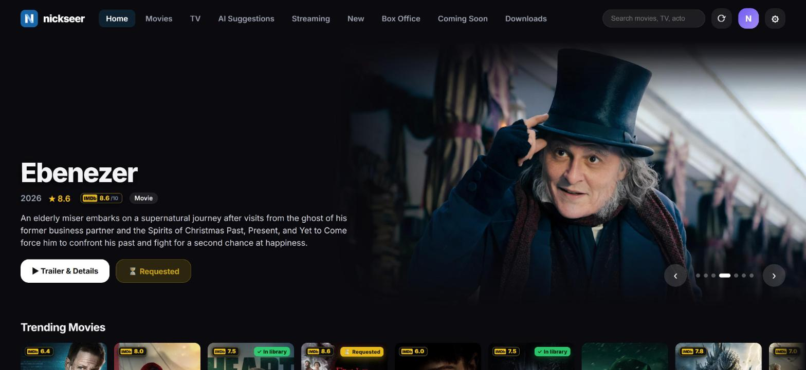
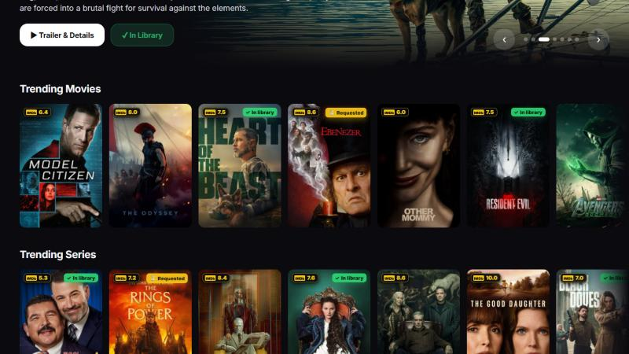
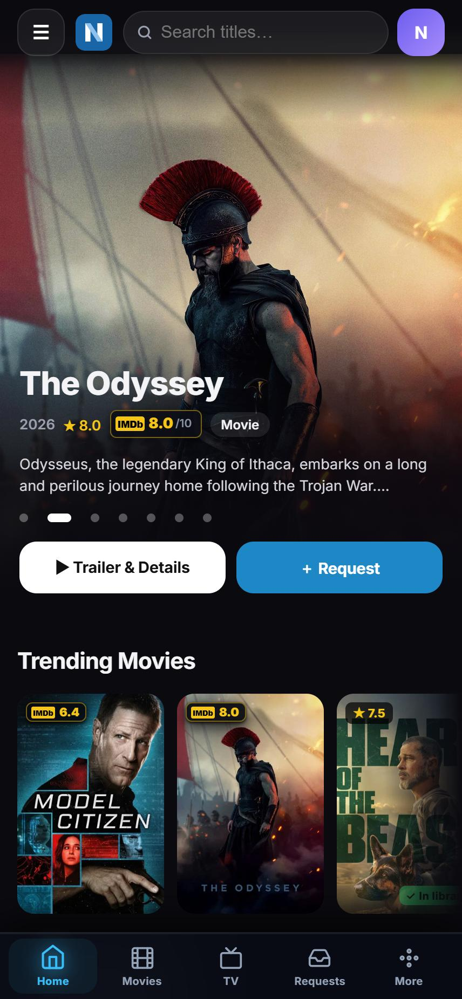

# NickSeer 🎬

A modern, self-hosted discovery hub and request manager for **Plex** & **Jellyfin** — featuring multi-server Plex synchronization, personalized recommendations, Box Office charts, AI taste curation, live streaming telemetry, and seamless one-click requests to **Radarr** & **Sonarr**, wrapped in a sleek Netflix/Apple-inspired UI.

> 🔒 **Security Notice:** This repository contains **NO personal data, tokens, or API keys**. All credentials (Plex, TMDB, Radarr, Sonarr, Tautulli, SABnzbd, etc.) are entered interactively in the web UI upon first launch and saved exclusively to your local `./config/` directory — never in this repository or Docker image.

---

## 📸 Screenshots

<p align="center">
  
</p>

<p align="center">
  
</p>

<p align="center">
  
</p>

<sub>Artwork and titles are provided by TMDB and belong to their respective owners.</sub>

---

## ✨ Key Features

### 👑 1. Multi-Server Plex Integration & Ownership Verification
- **Multi-Server Detection:** Seamlessly switches between your owned servers and invited/shared friend servers with instant library section re-scanning.
- **Selective Library Sync:** Choose exactly which movie and TV libraries to scan for ownership and exclude shared friend libraries.
- **Universal IMDb & TMDB Badges:** High-contrast yellow `[IMDb]` scores and secondary `[TMDB]` ratings on all posters and detail modals.

### 📱 2. Native Mobile App Experience (PWA) & Cloudflare Ready
- **Installable PWA (iOS & Android):** Add to Home Screen to run NickSeer as a full-screen native standalone app with zero browser URL bar or browser chrome.
- **Sleek Minimalist Navigation:** Modern vector SVG bottom navigation bar with Apple TV / Netflix styling.
- **Overseerr-Style Season Selector:** Interactive season request table with individual episode counts, master toggles, and smooth bottom-sheet modals.
- **Swipe-to-Dismiss Sheets:** Detail, person and request sheets can be dragged down to close, with the backdrop fading as you drag.
- **Pull to Refresh:** pull down from the top of any list view to reload it.
- **Tabs that behave like an app:** each tab remembers where you were scrolled to, tab changes cross-fade, and tapping the tab you are already on jumps back to the top.
- **Portrait artwork on phones:** the slideshow uses the tall poster on small screens, placed below the top bar so faces are not hidden behind it.
- **Share sheet:** share any title from its detail sheet with the native iOS / Android share menu.
- **Opens Plex and IMDb apps (iPhone / iPad):** "Open in Plex" and IMDb links open the installed app on that title, and fall back to the web page if the app is not installed.
- **App icon badge:** admins see the number of requests waiting for approval on the Home Screen icon.
- **Updates itself:** the installed app notices when a newer version is deployed and reloads at a safe moment — no need to close and reopen it.
- **Tuned for real phones:** posters are requested at the size they are actually drawn, long rails are capped on small screens, and rating badges are painted only for cards near the viewport — together these cut decoded image memory on the Movies/TV tabs by roughly 75% and keep scrolling at a steady frame rate.
- **Consistent Press Feedback:** a single motion system across every button, chip and nav item — 48px minimum touch targets, one spring curve, and a full `prefers-reduced-motion` fallback.
- **Cloudflare Tunnel Hardened:** Real client IP extraction (`CF-Connecting-IP`), brute-force login rate limiting, security headers, and 24-hour CDN edge caching for static assets.

### 🤖 3. AI Taste Curation (Local LLM & OpenAI)
- **Deep Taste Profiling:** Analyzes your Plex / Tautulli 60-day watch history to determine core genres, dramatic tone, and narrative depth.
- **Smart Filtering:** Intelligent genre affinity scoring automatically filters out children's cartoons, kids' TV, and concert films for viewers who primarily watch mature prestige dramas and thrillers.
- **Contextual Justifications:** Every recommendation includes a concise 4-6 word AI reason (e.g. *"Gritty crime saga with intense drama"*).
- Supports **Ollama**, **llama.cpp**, **LM Studio**, and **OpenAI (GPT-4o-mini)**.

### 🎨 4. Authentic Official Brand Vector Assets
- **Exact Official SVGs:** Directly integrated from official GitHub repositories for **Radarr**, **Sonarr**, **Tautulli**, **Plex**, **SABnzbd**, **Gluetun**, and major streaming platforms (**Netflix**, **Disney+**, **Prime Video**, **Max**, **Apple TV+**, **Paramount+**).

### 👥 5. Netflix-Style Multi-User Profiles & RBAC
- **"Who's Watching?" Profile Picker:** Switch between family profiles seamlessly.
- **Role-Based Access Control (RBAC):** Admin users manage users, approvals, and server settings. Standard user accounts (family/friends) are automatically restricted from viewing backend configurations, server hostnames, or other users' request history.
- **Sign in with Plex:** One-click Plex OAuth authentication that auto-provisions user profiles. Works from phones and the installed Home Screen app as well as desktop.
- **Sign in with Face ID / Touch ID / Windows Hello:** after signing in once, add a passkey from the profile menu and use your device's unlock from then on. Requires the site to be served over https.
- **Profile rules:** admins see every profile and can browse as any of them; standard users only ever see and use their own. The list of accounts is not shown to anyone who is signed out.

### 📥 6. Request Management & Approvals Workflow
- **Automated Routing:** Automatically checks Plex library availability; if missing, routes requests directly to Radarr (Movies) or Sonarr (TV).
- **Admin Approvals Queue:** Dedicated tabs (`⏳ Pending`, `✓ Approved`, `✕ Declined`, `All`) with live badge counts and inline request editing (*quality profiles, root folder paths, tags*).

### 🤖 7. Overseerr API Compatibility & Requestrr Discord Bot
- **Full `/api/v1` Emulation:** Built-in drop-in Overseerr API compatibility layer allowing tools like **Requestrr** to interact directly with NickSeer.
- **Requester Attribution:** Maps external user IDs (`X-API-User`) directly to corresponding local NickSeer user accounts.
- **Radarr & Sonarr Webhooks:** Ingests media import/download webhooks at `/api/v1/webhook` to automatically mark items as `Available` in real time.
- **Authenticated by default:** both surfaces require a shared secret — see [Connecting Requestrr, Radarr & Sonarr](#-connecting-requestrr-radarr--sonarr).

### 📊 8. Overseerr Movie & Series Metadata Hub
- **Rich Technical & Financial Data:** Embedded metadata block directly in the details modal showcasing TMDB Status, Formatted Release Date (with ticket icon), Worldwide Revenue, Production Budget, Original Language, Production Country with flag emoji, and Studio name.
- **Adaptive Layout:** Clean responsive design system integration matching the dark glassmorphic theme across desktop, tablet, and mobile.
- **Cast & Crew Pages:** tap anyone in a title's cast to open their page — portrait, age and birthplace, a biography you can expand, what you already have of theirs, what they are *known for*, what is *coming up*, and their latest work. **See all** opens the full filmography in its own window: every title as a large poster with its IMDb rating, filterable by films, series or "in library", sortable by newest, oldest, top rated, lowest rated or A–Z, and requestable in one tap. Back always returns to where you came from — title, person or filmography — at the spot you left. "Known for" is ranked by real roles: talk-show and guest appearances are left out, and directors and writers lead with the work they made.

### 🔔 9. Automated Notifications (Telegram & Discord) & Hardware Telemetry
- **Instant Alerts:** Dispatches rich notification cards to **Telegram** and **Discord** for request events (Pending, Approved, Declined, Available).
- **Push notifications to your phone:** turn them on from the profile menu. Admins are told about new requests; requesters are told when theirs is approved, declined or available. No third-party service or account is needed. On iPhone this requires the app to be installed to the Home Screen (iOS 16.4 or later).
- **Host Telemetry & Monitoring:** Live CPU utilization, thermal sensor monitoring, RAM telemetry, and sustained temperature threshold alerts.

### 🎬 10. Movie Collections & Franchise Browser
- **Franchise Sagas:** Interactive collection browsing with complete franchise completion tracking and batch requesting.

### 🗓️ 11. Coming Soon by Streaming Service
- **"Coming to…" rows:** upcoming series and films for each streaming service available in your region, built from the service's own networks and studios — new series first, then returning series with new episodes on the way.
- **Status at a glance:** posters and the slideshow show *Requested* or *In Library* straight away, without opening the title.
- **Widescreen slideshow on desktop:** artwork is shown whole at its own shape with soft faded edges, rather than cropped to fill the window.

---

## 🚀 Quick Start (Docker Compose)

### 1. Recommended `docker-compose.yml`

```yaml
version: "3.8"

services:
  nickseer:
    image: ghcr.io/nicklnn/nickseer:latest
    container_name: nickseer
    restart: unless-stopped
    ports:
      - "5056:5056"
    environment:
      - TZ=Europe/Athens
      - PUID=1000
      - PGID=1000
    volumes:
      - ./config:/config   # Persists all settings, API keys & user accounts
      # Hardware sensors for accurate Live Streaming thermals & NAS RAM telemetry
      - /sys/class/thermal:/sys/class/thermal:ro
      - /sys/class/hwmon:/sys/class/hwmon:ro
      - /proc/meminfo:/host/proc/meminfo:ro
```

### 2. Launch Container
```bash
docker compose up -d
```

### 3. Complete First-Run Setup
1. Open your browser and navigate to **`http://<your-server-ip>:5056`** (or your Cloudflare Tunnel domain).
2. The **First-Run Setup Wizard** will guide you through connecting:
   - **TMDB API Key** (Free from [themoviedb.org](https://www.themoviedb.org/settings/api))
   - **Plex Server URL & Token**
   - *(Optional)* **Radarr**, **Sonarr**, **Tautulli**, **SABnzbd**, **Gluetun**, and **Ollama**.
3. Create your Administrator account or enable **"Sign in with Plex"**.

---

## 🔌 Connecting Requestrr, Radarr & Sonarr

Both machine-to-machine surfaces are **authenticated**. They used to be open to anything that
could reach the host, which meant anyone on your network could mark requests available and
trigger your Telegram/Discord notifications. Each now requires a shared secret.

Both secrets are generated automatically on first boot. To read them at any time, open
**Settings → Requestrr Mock API → Integration secrets**, where NickSeer shows:

- the **API key Requestrr must send**, including which of the two possible sources is actually
  in effect, and
- a **ready-to-paste webhook URL** with the token already appended, built from the host you are
  currently using — so it is correct over LAN, a tunnel or a domain.

Both have a Copy button, and either can be regenerated in place if it leaks. (They are also
printed once to the container log at first boot and stored in `config/settings.json`, but you
should not need either.)

### Requestrr (and any Overseerr-compatible client)

Point it at NickSeer and give it the API key as the **`X-Api-Key`** header:

| Setting | Value |
|---|---|
| Hostname / IP | your NickSeer host |
| Port | `5056` |
| API Key | the value shown under **Integration secrets** in Settings |

> **Note the precedence.** NickSeer accepts `services.overseerr.apikey` first and falls back to
> `api.key`. If both exist, the Overseerr one wins — using the other returns `403 Forbidden` on
> every route.

### Radarr & Sonarr webhooks

In **Settings → Connect → Webhook**, set the URL with the token appended:

```
http://<your-nickseer-host>:5056/api/v1/webhook?token=<your webhook token>
```

Settings shows this URL fully built — copy it rather than assembling it by hand.

Method `POST`. An `X-Webhook-Token` header works too, if you prefer keeping the secret out of
the URL.

Recommended triggers: **On Grab**, **On File Import**, **On File Upgrade**. The **Test** button
returns `{"ok":true,"status":"ignored"}` — that is success; only real `Download` events change
state.

<details>
<summary>Diagnosing a connection that will not authenticate</summary>

Set `REQUESTRR_DEBUG=1` in the container environment and restart. Every `/api/v1` call is then
appended to `requestrr_debug.log` with its method, URL and body, so you can see exactly what
the client sends — or confirm that nothing arrives at all. Turn it off afterwards: it is an
unbounded file and records request bodies in plaintext.

</details>

---

## 🧪 Development

```bash
npm test                          # offline, dependency-free unit suite
node test/sandbox/server.mjs 5099 # UI sandbox at http://127.0.0.1:5099
node test/sandbox/server.mjs 5099 --real-art   # same, with real TMDB artwork (for screenshots)
```

The **sandbox** serves the real `public/` directory against a fixture API so front-end changes
can be exercised in a browser without touching a live install. It deliberately does *not* boot
`server/index.js` — that starts hardware monitoring and can dispatch real Telegram/Discord
alerts. It reads no config, opens no connection to Plex/Radarr/Sonarr, and generates its
posters locally, so it needs no network and no API keys. The one exception is the optional
`--real-art` flag, which reads your TMDB key from the local config to load real titles and
artwork; everything else stays stubbed.

Fixtures are shaped to surface the bugs that are hard to eyeball: several hundred cards,
deliberate same-title collisions (Dune 1984/2021, IT 1990/2017) carrying different ratings, and
a share of entries with no IMDb rating.

---

## 🔄 Updating & Watchtower Safety

All configurations, credentials, user accounts, and request history reside exclusively in your `./config/` directory.

When updating the container:
```bash
docker compose pull
docker compose up -d
```
Or when managed automatically via **Watchtower**, your settings are **never overwritten or lost**.

---

## 🛠️ Build from Source

```bash
git clone https://github.com/NickLnn/NickSeer.git
cd NickSeer
docker compose up -d --build
```

---

## 📄 License

Distributed under the **MIT License**. See `LICENSE` for details.
